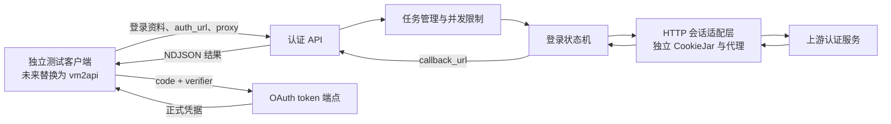

# Codex 独立认证应用建设方案

版本：0.1（设计稿）  
日期：2026-11-26  
适用阶段：独立开发与测试；通过验收后再接入 vm2api  
应用暂名：`codex-auth-service`

## 1. 目标与已确定的方向

建设一个独立认证应用：接收账号、密码、2FA 密钥、认证链接和代理，执行登录与工作区选择，取得本地回调 URL，返回调用方。调用方保存 PKCE verifier，并负责换票、验证身份和管理正式凭据。

用户已确定的开发顺序是：**先开发认证应用，单独测试通过，再接入 vm2api**。本方案据此划分独立交付范围和后续集成范围。当前仅形成设计，真实 HTTP 执行器和端到端换票尚未验证。

核心决策：

1. 认证应用为独立进程、独立镜像，首选与调用方同机部署。
2. 首版以纯 HTTP 执行登录为目标；动态认证材料与传输兼容性设为首个可行性验证关口。
3. `state / code_verifier / code_challenge` 由调用方生成；认证应用只获得授权链接中的 state 和 challenge。
4. 认证应用返回 `callback_url`，正式 token 只在调用方生成与保存。
5. 提供独立测试客户端，模拟未来 vm2api 的调用职责，实现完整端到端验收。
6. 首版每次任务创建独立临时会话，任务结束后释放；持久化 Cookie、跨任务复用登录态后置。
7. 首版保持一个活跃 HTTP 连接返回 NDJSON 事件；不建设持久化任务队列或完整管理面板。

“新建认证应用”指新增执行服务，沿用当前 Codex 授权流程的客户端配置。自行注册新 OAuth client 或变更上游允许的 redirect URI 属于另一个项目范围。

## 2. 证据、现状与待验证事项

### 2.1 参考资料

- [已有流程分析](codex-oauth-flow-analysis.md)。
- [早期请求汇总](codex-oauth-captured-requests.md)。
- 2026-11-26 的完整 HAR：本机文件 `C:/Users/yangrs/Downloads/download-with-content`。该文件包含敏感资料，只作本地分析源，不进入版本库或交付包。
- vm2api 现有 [PKCE 与换票模块](../src/lib/oauth/codex-oauth.mjs)、[外部登录服务适配器](../src/lib/oauth/codex-login-service.mjs)、[登录运行时](../src/lib/oauth/codex-login-runtime.mjs)。

早期文档包含“Web 登录 → 复用统一会话 → Codex 授权”的路径。最新 HAR 记录的是直接进入 Codex 的另一条路径，开发时优先使用最新样本，并按实际状态处理分支。

### 2.2 最新 HAR 已确认的事实

| 项目 | 观察结果 | 对实现的意义 |
|---|---|---|
| 记录规模 | 235 条请求；67 条携带 Cookie，191 条响应有 Set-Cookie | 足以分析本次登录的 Cookie 接力 |
| 授权入口 | `chatgpt.com/codex/desktop-auth` → `auth.openai.com/oauth/authorize` → 登录页 | 本次无需预先完成 ChatGPT Web 登录 |
| 邮箱提交 | `POST /api/accounts/authorize/continue` | 返回 `login_password` |
| 密码校验 | `POST /api/accounts/password/verify` | 返回 `mfa_challenge` |
| MFA 初始化 | `POST /api/accounts/mfa/issue_challenge` | 更新认证会话 Cookie |
| MFA 校验 | `POST /api/accounts/mfa/verify` | 返回 Codex consent，包含两个工作区 |
| 工作区选择 | `POST /api/accounts/workspace/select` | 返回 `external_url`，指向本地回调 |
| 会话接力 | 核心 session/checksum Cookie 在上述步骤持续更新 | 用 CookieJar 接收更新，避免手工拼接旧 Cookie |
| 可选 Cookie | 本次未出现统一会话 Cookie 与初始邮箱页 Cookie | 这些字段不是所有流程的固定前置条件 |
| 回调 | 包含 code 和 state，state 与授权入口一致 | 已观察到授权码签发 |
| 回调连接 | localhost 导航状态为 0 | 记录未证明本地回调接收成功 |
| 换票 | HAR 没有 `/oauth/token` | 尚未验证这次授权码的服务端换票 |

这是一条浏览器执行成功到授权码的样本，既不等于纯 HTTP 已跑通，也不代表每个账号都有相同分支。

### 2.3 待验证事项与决策关口

| 待验证项 | 验证产物 | 通过标准 |
|---|---|---|
| 动态认证材料 | 来源、时效、更新时机和运行环境依赖说明 | 从新会话取得当次有效材料，非重放 HAR 中的历史值 |
| HTTP 传输兼容性 | 实际客户端、代理与各步骤结果报告 | 选定客户端通过正常登录链；仅设置 UA 不算验证 |
| 直接 Codex 登录 | 新会话到 callback 的脱敏轨迹 | 无预置账号 Cookie，成功返回本次 callback |
| PKCE 完整链 | 测试客户端换票结果 | code 与本次 verifier 配对并换票成功 |
| 身份归属 | token 身份和目标工作区验证结果 | 邮箱及明确指定的工作区匹配 |

若某一步依赖浏览器运行环境，应记录具体依赖并重新决策执行引擎，保持外部接口不变。浏览器辅助路径应单独标记；该路径成功不计为纯 HTTP 验收通过。首版不通过执行器暗中启动浏览器来满足纯 HTTP 指标。

## 3. 范围与职责

### 3.1 本期交付

- 独立 HTTP 服务与调用鉴权。
- 纯 HTTP 登录引擎可行性验证及实现。
- 每任务 CookieJar、代理和截止时间隔离。
- 邮箱/密码/TOTP/工作区状态处理。
- 回调识别、格式和 state 检查。
- 进度、心跳、超时、取消、统一错误码。
- 独立 PKCE 测试客户端与换票验收。
- 本地启动说明、Dockerfile、可选 Compose 示例、脱敏诊断报告。

### 3.2 后置范围

- vm2api 业务代码改造和面板联动。
- 保存账号资料、维护正式 token、自动刷新和重登调度。
- 持久任务队列、跨实例恢复和任务迁移。
- 跨任务复用 Cookie、浏览器 profile 或统一登录态。
- 图形化管理台、交互式验证码续接、短信/邮箱收件系统。
- 多工作区逐个授权或自动选择默认工作区的产品策略。

首版遇到邮箱 OTP、短信、Passkey、额外验证或需要人工选择的分支，返回明确终态和阶段。人工续接作为后续独立能力，不留下永远处于运行态的任务。

### 3.3 职责矩阵

| 能力 | 认证应用 | 独立测试客户端 | 未来 vm2api |
|---|---|---|---|
| state / verifier / challenge | 读取链接中已有 state/challenge | 生成并保存 | 生成并保存 |
| 授权链接 | 验证并使用 | 生成 | 生成 |
| 账号及工作区目标 | 临时读取、检查 | 提供 | 按槽位提供 |
| 密码与 TOTP | 临时处理 | 从本地私有配置读取 | 从现有资料存储读取 |
| HTTP 登录会话 | 拥有 | 无 | 无 |
| 回调捕获 | 识别并返回 | 严格复核 | 严格复核 |
| `/oauth/token` | 不在本期职责内 | 执行 | 执行 |
| token 身份验证 | 无正式 token | 执行验收 | 在提交前执行 |
| 正式凭据持久化与刷新 | 无 | 默认不持久化；按显式选项本地保存 | 复用凭据生命周期 |

## 4. 总体架构



### 4.1 技术选型

首选 Node.js 22 + TypeScript，保持与 vm2api 的语言、部署和调试方式接近；这是工程默认选择，不是对上游兼容性的预先保证。

| 部分 | 建议 | 理由 |
|---|---|---|
| HTTP 服务 | Node 原生 HTTP 或轻量框架，择一锁定 | API 少，便于控制 NDJSON flush 和断连 |
| 上游客户端 | 封装 HTTP transport；初始候选 `node-fetch` + `socks-proxy-agent` / `https-proxy-agent` | 复用成熟代理支持，方便替换传输实现 |
| Cookie | `tough-cookie` 配合明确的响应处理 | 保留域、路径、有效期与同名 Cookie 语义 |
| TOTP | 维护中的库，RFC 测试向量验证 | 避免自制时间码算法 |
| 测试 | Node 测试框架或 Vitest，统一一种 | 本地 mock server、计时器和断连用例 |
| 打包 | 独立 Docker 镜像，锁定依赖 | 不依赖 vm2api 镜像内容 |
| 存储 | 首版内存任务表 | 不引入数据库和分布式状态 |

P0 阶段先验证候选 transport 是否满足真实链路要求，再冻结依赖。TLS、HTTP 协议协商、Cookie 行为和代理 DNS 都纳入验证；增加浏览器风格请求头不等于具备浏览器传输行为。

### 4.2 建议项目结构

应用使用独立目录或仓库；本文件放在 vm2api/docs 便于评审，不表示实现必须依赖 vm2api 源码。

```text
codex-auth-service/
  src/
    server.ts
    config.ts
    api/                 # 请求校验、NDJSON、取消、健康状态
    tasks/               # 注册表、并发、截止时间、幂等保护
    auth/                # 状态机、状态解析、工作区策略
    transport/           # HTTP、CookieJar、代理、重定向
    callback/            # 回调校验与结果生成
    security/            # 日志脱敏、服务鉴权、URL 校验
  tools/auth-smoke/       # 独立测试客户端；verifier/token 只在这里处理
  test/fixtures/         # 人工构造或白名单提取的脱敏样本
  docs/                  # API、运维、验收报告
  Dockerfile
  compose.example.yml
  .env.example
```

## 5. 外部 API 契约

### 5.1 版本与兼容策略

采用 **callback 协议 v2**，端点统一为 `/v2/*`，与 vm2api 现有“返回 credential”的旧登录契约区别。旧服务不需要跟随本应用修改，未来由 vm2api 配置显式选择协议。

| 方法与路径 | 用途 |
|---|---|
| `GET /healthz` | 进程存活；不请求上游，不返回账号或配置秘密 |
| `GET /readyz` | 配置和执行引擎就绪；非上游账号探测 |
| `POST /v2/authenticate` | 发起登录，保持 NDJSON 响应直到终态 |
| `GET /v2/tasks/:task_id` | 返回脱敏状态；不返回回调、账号密码或 Cookie |
| `DELETE /v2/tasks/:task_id` | 幂等取消；取消已完成任务不会撤回已交付结果 |

业务端点使用 `Authorization: Bearer <service-token>`。首版按单一可信调用方部署；若配置多个调用方 token，任务查询和取消必须绑定创建任务的调用方身份。

### 5.2 请求

```http
POST /v2/authenticate
Authorization: Bearer <service-token>
Content-Type: application/json
Accept: application/x-ndjson
```

```json
{
  "protocol_version": 2,
  "task_id": "<uuid>",
  "email": "<email>",
  "password": "<password>",
  "mfa_secret": "<base32-secret-or-null>",
  "auth_url": "<caller-generated-codex-authorize-url>",
  "proxy": "socks5h://<user>:<password>@<host>:<port>",
  "expected_account_id": "<workspace-id-or-null>",
  "expires_at": "<ISO-8601-UTC>"
}
```

| 字段 | 规则 |
|---|---|
| `protocol_version` | 固定为 2；未知版本在开始执行前返回 422 |
| `task_id` | 调用方生成 UUID，同一调用方内唯一；查询和取消使用该值 |
| `email` | 必填；比较时 trim 和小写，不改变原始认证语义 |
| `password` | 必填、非空；不 trim，不写入日志 |
| `mfa_secret` | 字段必填，可为 null；null 允许无 MFA 账号，实际出现 TOTP 时返回 `mfa_secret_required` |
| `auth_url` | 必填；由调用方生成，必须通过入口与内层参数校验 |
| `proxy` | 字段必填；URL 表示明确代理；null 表示显式直连，需部署配置允许 |
| `expected_account_id` | 字段必填，可为 null；有值时只选择该工作区 |
| `expires_at` | 必填；调用方 OAuth 会话的截止时间，非队列等待时间 |

首版建议请求体上限 64 KiB，授权 URL 上限 16 KiB。2FA 只接收约定的 Base32 secret，验证格式但不静默猜测其他输入格式；后续增加 otpauth URI 时另立明确规则。

### 5.3 授权 URL 处理

- 接受现有 Desktop 外层入口以及显式支持的 `auth.openai.com/oauth/authorize` 直连入口。
- Desktop 的内层 `authorize_url` 只解包一次；检查外层和内层的 scheme、host、port、path 和重复参数。
- 校验 `response_type=code`、预期 `client_id`、固定 `redirect_uri`、非空 state、S256 challenge 和必要 scope。
- 首版固定 callback 为 `http://localhost:1455/auth/callback`，严格保持与调用方换票使用的值一致。新增其他回调地址需作为独立配置变更。
- 认证应用保留调用方提供的合法授权参数，不重新生成 state/challenge，不拼接到已有会话中。
- `code_verifier`、API 密钥、正式 token 均不属于请求契约；额外敏感字段按输入校验策略拒绝。

### 5.4 NDJSON 事件

成功接收任务后使用 `Content-Type: application/x-ndjson`、`Cache-Control: no-store`，立即发送首事件。每个事件一行，包含递增 seq；每 15 秒发一次心跳并 flush。

```json
{"type":"accepted","task_id":"<id>","seq":1,"stage":"authorizing"}
{"type":"progress","task_id":"<id>","seq":2,"stage":"verifying_password"}
{"type":"heartbeat","task_id":"<id>","seq":3,"stage":"verifying_password"}
{"type":"result","task_id":"<id>","seq":4,"payload":{"status":"callback_ready","callback_url":"http://localhost:1455/auth/callback?code=<code>&state=<state>&iss=https%3A%2F%2Fauth.openai.com"}}
```

失败终态：

```json
{"type":"result","task_id":"<id>","seq":4,"payload":{"status":"failed","error":{"code":"mfa_failed","stage":"verifying_mfa","retryable":false}}}
```

规则：

- 每个正常完成的连接最多一个 result；发送终态后结束响应。客户端断连后以服务端清理和任务状态为准，不承诺仍能交付事件。
- `callback_ready` 只表示授权码阶段完成，不表示换票或账号导入成功。
- 事件 stage 和 error code 使用白名单枚举；不透传上游错误正文、账号信息或 URL 查询串。
- 输入、鉴权或容量问题在开始流之前返回 4xx/5xx JSON；流已经开始后，业务失败使用 result，不试图改写 HTTP 状态。
- 建议单事件上限 64 KiB，单任务事件总量上限 1 MiB；心跳和进度有频率上限。
- 反向代理必须关闭响应缓冲；服务与调用方总超时和空闲超时需要同时配置。

### 5.5 幂等、并发和结果交付

首版不设置内部等待队列。默认全局并发 2，容量满时返回 429 和 `Retry-After`；任务不启动，也不持有登录资料。调用方完成自己的排队后，再生成授权链接并提交任务。

- 同一 task_id 已在运行：返回 409 `task_already_running`，不启动第二次登录。
- 同一 task_id 已终止：返回 409 `task_already_finished`。终态元数据保留 10 分钟，用于查询和去重，不保存敏感结果。
- 请求流断开：终止任务、清理；新尝试使用新 task_id 和新 OAuth 会话。
- callback_url 仅通过原 POST 连接交付一次，查询接口不回放。即使写入 socket 成功，也只代表尝试交付，不代表调用方已持久接收。
- 若回调结果丢失，首版新建授权任务恢复；不通过继续运行旧任务或重复使用旧授权码恢复。

这一选择降低首版存储与恢复复杂度。需要断线重连和持久结果时，另行设计带过期、加密和消费确认的结果存储协议。

## 6. 登录状态机与执行规则

### 6.1 状态定义

```text
accepted → authorizing → identifying → verifying_password
         → issuing_mfa → verifying_mfa → selecting_workspace
         → capturing_callback → callback_ready

任一非终态 → failed / canceled / expired
```

以上是样本主线；实际根据页面状态跳转，允许无 MFA 或直接出现 consent。`callback_ready / failed / canceled / expired` 为终态。

| 状态 | 行为 | 转移依据 |
|---|---|---|
| authorizing | 打开授权入口，接收重定向和初始化 Cookie | 当前页面、响应及会话状态 |
| identifying | 提交账号标识 | login_password、其他登录方式或错误 |
| verifying_password | 提交密码 | MFA、consent 或明确错误 |
| issuing_mfa | 按当前分支初始化挑战 | 上游返回的 factor 和会话状态 |
| verifying_mfa | 计算当前 TOTP，提交挑战验证 | consent、workspace 或错误 |
| selecting_workspace | 按目标 ID 或唯一候选选择 | external_url 或附加分支 |
| capturing_callback | 识别回调、校验 state 和结果类型 | callback_ready 或失败 |

具体接口以实际轨迹为准。首版参考接口是 authorize/continue、password/verify、mfa/issue_challenge、mfa/verify、workspace/select。manifest 中出现路由不等于该请求一定发生；同样，浏览器内路由跳转也不应机械转换成额外 GET。

### 6.2 工作区策略

1. 有 expected_account_id：要求候选列表包含该 ID；找不到则返回 `workspace_not_found`。
2. 无目标且候选恰好一个：选择唯一候选。
3. 无目标且候选多于一个：终止为 `workspace_selection_required`；在鉴权的结果中可返回候选 ID、kind 和必要显示名，供调用方重新发起指定目标的任务。该候选列表不写普通日志，也不进入查询接口。
4. 无候选：返回 `workspace_unavailable`。
5. 会话响应提供邮箱时与输入比较；不一致返回 `identity_mismatch`。最终 token 身份仍由调用方验证。

本次 HAR 的账号有两个工作区，真实首次验收必须明确目标 ID，避免“默认第一个”造成假成功。

### 6.3 Cookie 和请求状态

- 每任务独立 CookieJar；同一个账号的两个任务也不共用对象。
- 所有响应，包括 3xx，都先处理完整 Set-Cookie，再处理后续跳转。
- 保留 Domain、Path、Secure、过期和删除语义，以及不同路径的同名 Cookie；Set-Cookie 多值独立解析，避免按逗号切分 Expires。
- 需要验证所选 Cookie 库对 SameSite、Partitioned 等属性的实际支持范围；记录与浏览器的差异，不能仅凭“支持 CookieJar”推断行为完全一致。
- 会话/checksum 等上游签发字段保持原值接力；状态中的 ws 只作观察，不由客户端按数字合成。
- auth-page、factor_id、workspaces 等以当前响应为准；每个请求的字段按实际分支决定，避免一套固定认证头覆盖所有步骤。
- 任务内部认证请求顺序执行；只有确认为只读且无会话写入的操作才允许并行。

### 6.4 代理与重定向

- 每任务所有上游请求使用同一代理配置和会话；代理失败返回错误，不静默退回直连。
- 显式代理模式关闭环境代理的隐式覆盖；显式直连模式也不自动继承环境代理。
- 支持的代理 scheme 明确列出：首选 socks5h；HTTP/HTTPS 代理通过对应 adapter。DNS 行为纳入真实验收。
- 认证应用与调用方之间的控制请求不经过账号代理。
- 手动处理重定向，限制总跳数（建议 12）并检测循环；303、307、308 等 method/body 语义按协议实现，不任意重发密码正文。
- 使用明确的上游域名允许列表，初始包含本次所需的 auth/chatgpt/sentinel 等具体域名。新增域名先核实角色再加入，不开放任意目标。
- 检测到固定 callback 地址时先截获，避免真的请求 localhost。密码、Cookie 或 Authorization 头不会跨域原样转发。
- 代理本身可能是回环或内网地址，这是合法部署场景；代理目标校验与上游授权 URL 校验分开实现。

### 6.5 TOTP、额外分支与重试

- 以当前 factor 返回值选择 TOTP；不缓存前一次登录的 factor_id。
- 支持的默认 TOTP 参数与账号配置一致，使用测试向量验证；保持系统时间同步。
- 接近时间窗口边界时，可在任务预算内等到下一窗口再生成一次验证码。已提交后不盲目遍历多个时间窗口。
- 无 MFA secret 而上游需要 TOTP：`mfa_secret_required`。
- 邮箱 OTP、短信、Passkey、Step-up 等未支持分支：`interaction_required`，附白名单 challenge_kind。
- 遇到页面状态或响应结构未知：`unsupported_auth_state`，保留脱敏诊断信息，避免循环提交。
- 对可能已经被服务端处理的认证 POST，不做通用自动重试。连接错误、429、5xx 的是否可重试分别分类，由新任务策略决定。

## 7. 截止时间、取消与资源管理

| 项目 | 首版默认 |
|---|---|
| 调用方 OAuth 会话有效期 | 10 分钟，与当前 vm2api 对齐 |
| 为调用方换票预留 | 60 秒 |
| 任务认证截止 | `min(expires_at - 60s, accepted_at + 540s)` |
| 接收时最少剩余有效时间 | 90 秒，否则 422 `auth_session_expiring` |
| 普通上游单请求超时 | 最多 30 秒，且受任务剩余时间限制 |
| 心跳 | 每 15 秒 |
| 建议调用方流空闲超时 | 60 秒 |
| 全局并发 | 2，可配置 1–8；提高前先测资源 |
| 内部排队 | 无；满载返回 429 |
| 终态脱敏元数据 | 10 分钟，有数量上限 |

调用方和服务端时钟保持同步，初期允许约 5 秒的测量偏差；最终由严格的剩余预算判断是否继续。任务执行使用单调时间计算本地 deadline，避免运行中系统时钟回拨延长任务。

取消来源包括 HTTP 断连、DELETE 请求、截止时间和服务关闭。每个任务拥有 AbortController，取消传递到上游请求、TOTP 等待和所有后续步骤。

收到 SIGTERM 后停止接收新任务，取消活跃任务，在有限宽限期内清理并退出。首版不恢复内存任务；调用方重建 OAuth 会话。

清理包括关闭任务连接、释放 CookieJar 和敏感字段引用、移除定时器。Node 字符串在垃圾回收前可能仍留于内存，文档与实现不宣称强制内存清零。

## 8. 错误分类

| 错误码 | 含义 | 默认处理 |
|---|---|---|
| `invalid_request` / `invalid_auth_url` | 输入或授权参数不符合契约 | 修正调用参数 |
| `unauthorized` | 服务鉴权失败 | 修正服务密钥 |
| `capacity_exceeded` | 服务满载 | 调用方排队，稍后生成新会话 |
| `task_already_running` / `task_already_finished` | task_id 重复 | 查询状态，避免重复执行 |
| `proxy_unreachable` | 出口连接失败 | 修复代理后新任务 |
| `upstream_rate_limited` | 上游限流 | 遵循 Retry-After 或调用方退避 |
| `upstream_unavailable` | 上游服务异常 | 冷却后重建任务 |
| `password_rejected` | 上游明确拒绝密码 | 更新资料，停止自动连试 |
| `mfa_secret_required` / `mfa_failed` | 缺少密钥或验证失败 | 检查资料及时间同步 |
| `interaction_required` | 出现尚未支持的交互验证 | 人工处理或后续续接能力 |
| `workspace_selection_required` | 多工作区且未指定 | 明确目标后重新发起 |
| `workspace_not_found` / `workspace_unavailable` | 目标或列表异常 | 核实账号空间 |
| `identity_mismatch` | 已观察身份与输入不一致 | 丢弃结果并检查会话隔离 |
| `unsupported_auth_state` | 新页面或未识别结构 | 根据脱敏轨迹修复状态机 |
| `callback_invalid` / `state_mismatch` | 回调格式或任务归属错误 | 丢弃回调 |
| `oauth_authorization_error` | 上游返回 error 回调 | 返回归一化错误，不包含原文 |
| `auth_session_expiring` / `expired` | 授权时间不足或已过期 | 新 OAuth 会话 |
| `canceled` | 调用方或关闭流程取消 | 清理任务 |
| `internal_error` | 执行器自身异常 | 脱敏诊断，避免原始堆栈进入响应 |

`retryable=true` 表示调用方可以考虑退避后发起新任务，不表示可以原样重放某个认证 POST 或旧授权码。401/403/HTML 页面要结合阶段与结构分类，不统一归结为密码错误。

## 9. 回调契约与调用方换票

### 9.1 认证应用的检查

回调可以来自 JSON continue_url、external_url 或重定向 Location。使用同一个解析器处理，严格检查：

- scheme、hostname、port、path 与授权请求中的固定 redirect_uri 一致。
- 拒绝 userinfo、fragment、重复 code/state/error 等歧义字段。
- 成功回调要求非空 code、非空 state，且 state 与本次授权链接完全相同。
- 若包含 iss，要求与预期签发者一致；若未包含，按已确认的协议配置处理，不能只根据未经校验的 iss 选择换票端点。
- 若包含 OAuth error，返回失败终态；不把 error 回调作为 callback_ready。
- code 和 callback URL 只经受保护的原响应流交付，不输出到普通日志或状态查询。

### 9.2 独立测试客户端

测试客户端和服务进程分离，承担未来 vm2api 的职责：

1. 读取本地私有输入配置，生成高熵 state 和 verifier，以 S256 派生 challenge。
2. 按已确认参数生成授权链接，保存本次 task_id、state、verifier、redirect_uri、出口和目标工作区。
3. 调用认证应用并消费 NDJSON，终端仅显示阶段和脱敏结果。
4. 独立复核回调 URL、state、任务有效期和尚未消费状态。
5. 只向固定的 token 端点提交 `grant_type=authorization_code`、client_id、code、redirect_uri、verifier，使用 form-urlencoded，经与认证相同出口发送。
6. 记录换票是否成功，检查所需 access/refresh/id token 是否齐全。
7. 对 ID token 做签名及 issuer、audience、有效期校验，使用经核实的官方 OIDC/JWKS 元数据；检查邮箱及目标 account ID。仅 Base64 解码不计为身份真实性验证。若实际 token 声明或元数据与预期不同，先更新验证契约再判定通过。
8. 输出本地脱敏报告；可选执行一次只读目录探测并单独报告结果，不发付费推理请求。

所有正式 token 默认只在测试客户端内存中保留。需要验证落盘时使用显式选项写入仓库外私有文件；Unix 0600、Windows 仅当前用户 ACL。打印“token 已取得”即可，不打印值。

测试工具不通过命令行参数接收密码、secret 或 callback，以免进入进程列表或 shell 历史；通过受限配置文件或交互输入获取。

### 9.3 单次消费与不确定结果

调用方收到回调后，原子切换本地会话为 `exchanging`，阻止同一回调触发并行换票。成功后标记 consumed。

如果 token 请求可能已到达上游但响应丢失，记录 `exchange_outcome_unknown`，不自动重复提交。第一版通过新授权会话恢复；上游明确拒绝则记录归一化 OAuth 错误。callback_ready 和端到端成功分别统计。

## 10. 部署、配置与运维

### 10.1 部署形态

开发时在本机独立启动；Linux 初期使用同机 sidecar，监听 `127.0.0.1:8788`，服务 token 仍必需。当前 vm2api 默认 host 网络，同机 host 网络执行器可以减少代理地址转换。

若使用 bridge 网络，可发布宿主回环端口，但需单独验证任务代理地址的可达性。容器内 `127.0.0.1` 指向容器；只添加 host 别名也未必能访问只绑定宿主 loopback 的代理。Windows 开发期优先本机进程，避免把 Linux host 网络假设套到 Docker Desktop。

异机部署使用 HTTPS，并保证认证应用与调用方能通过各自可达地址到达同一槽位出口。测试客户端使用的代理 URL 可以与服务端地址不同，但应验证最终出口一致。初期优先同机，减少这一变量。

### 10.2 建议配置

| 配置 | 默认/说明 |
|---|---|
| `AUTH_LISTEN_HOST` | `127.0.0.1` |
| `AUTH_LISTEN_PORT` | `8788` |
| `AUTH_SERVICE_TOKEN_FILE` | 必填，受限文件或容器 secret |
| `AUTH_MAX_CONCURRENCY` | `2` |
| `AUTH_ALLOW_DIRECT` | `false`；仅显式启用后接受 proxy=null |
| `AUTH_TASK_MAX_SECONDS` | `540`，仍受 expires_at 约束 |
| `AUTH_EXCHANGE_RESERVE_SECONDS` | `60` |
| `AUTH_REQUEST_TIMEOUT_SECONDS` | `30` |
| `AUTH_HEARTBEAT_SECONDS` | `15` |
| `AUTH_RESULT_META_TTL_SECONDS` | `600` |
| `AUTH_LOG_LEVEL` | `info`，debug 同样遵守脱敏 |

上游入口、client ID、scope 和 redirect URI 集中于版本化配置模块，调整时有测试覆盖；不允许普通请求任意指定 token 端点或放开允许列表。

### 10.3 可观察性

日志字段仅包括 task_id、阶段、耗时、归一化错误码、上游状态码、允许的路径标识。避免记录完整 URL、请求头、请求体、响应体和代理凭据。

建议指标：活跃任务数、接收/拒绝数、callback_ready 数、阶段耗时、失败分类、取消数、超时数。账号邮箱、工作区 ID 和 task_id 不作为指标标签，避免泄露与高基数。

应用 readiness 只表示服务已准备好接收任务；上游是否接受某账号由实际任务结果决定。

### 10.4 敏感资料处理

- 服务端仅在任务存活期间持有密码、2FA secret、Cookie、动态认证材料和 callback。
- 日志与错误采用字段白名单，异常对象也经过过滤；框架的自动 request/body logging 关闭。
- 原始 HAR 留在本机，仓库仅保存提取后的人工检查样本；静态 JS/HTML 也可能夹带会话信息，避免整段原样复制。
- 独立账号资料文件、HAR、token 输出和本地报告原始附件加入忽略规则。
- 服务容器使用普通用户，无主库凭据、无 vm2api 目录挂载、无 Docker socket。
- 如需保存问题复现资料，显式开启有限时长诊断并只保存脱敏结构；常规运行不持久化上游正文。

## 11. 测试与验收

开发期间按模块验证，完整真实链路回归放在开发完成后集中执行；P0 仍需最小真实实验，确认纯 HTTP 关键依赖可行，避免后续建立在未经验证的假设上。

### 11.1 本地自动化测试

| 类别 | 必测场景 |
|---|---|
| 输入与 URL | 错误 client/redirect、重复 query、嵌套 URL、非法 scheme、未知协议版本 |
| Cookie | 多 Set-Cookie、更新、删除、过期、不同 path 同名、3xx 响应、属性兼容 |
| 状态机 | 正常密码+TOTP、无 MFA、未知状态、缺 factor、额外交互分支 |
| 工作区 | 指定目标存在/缺失、唯一候选、多候选未指定、返回身份不一致 |
| TOTP | 标准向量、窗口边界、缺密钥、格式错误、任务取消时等待结束 |
| 回调 | state 缺失/错误、重复字段、OAuth error、错误 host/port/path、fragment |
| HTTP | 重定向循环、超跳数、Cookie 顺序、敏感头跨域、代理失败不直连 |
| 任务 | 同 ID 并发、满载、过期、断连、DELETE 取消、SIGTERM 清理 |
| 流协议 | 心跳及时 flush、终态唯一、半行读取、事件大小限制 |
| 敏感资料 | 日志、状态接口、错误响应、异常堆栈均不包含测试秘密 |
| 调用方 | 回调重复到达、换票单次消费、响应丢失、token 身份不匹配 |

mock 上游主要验证会话和协议行为，不用 mock 成功代替真实上游兼容验证。

### 11.2 真实验收矩阵

| 场景 | 要求 |
|---|---|
| 新会话、密码+TOTP、指定工作区 | callback 正确，测试客户端换票成功、身份匹配 |
| 同一账号再次新建独立任务 | 使用全新 state/verifier，未借用上次 Cookie 或认证材料 |
| 两个独立任务并发 | Cookie/代理/回调均不串任务；测试可用同账号或不同账号，但分别检查 state |
| 本地/远程代理路径 | 服务与换票客户端最终出口符合约定，DNS 行为明确 |
| 超时或取消 | 停止后续上游请求并释放并发槽，目标清理时间不超过 5 秒 |
| 多工作区且未指定 | 返回明确候选选择错误，不默认选第一项 |
| token 身份异常 | 测试客户端不把该次运行标为通过 |

错误密码、错误验证码、限流和特殊账号状态优先在 mock 环境覆盖；真实故障实验控制次数，避免把重复错误提交当作压力测试。

### 11.3 分层通过标准

- **契约通过**：mock 下服务、流协议、回调校验、超时和取消符合约定。
- **认证应用通过**：纯 HTTP 新会话取得匹配 task/state 的真实回调；关键 Cookie 和出口可追溯。
- **端到端通过**：独立客户端换票成功，并验证身份、目标工作区与 token 基本有效性。
- **可集成通过**：以上通过，至少 3 次独立新会话成功，另有并发隔离与清理证据，运维文档完整。

若某种账号分支缺少实际样本，在报告中写明“mock 覆盖、真实未测”，不扩大兼容声明。只读探测结果与换票结果分列，探测失败按真实原因排查。

### 11.4 验收报告模板

```text
构建版本 / 引擎 / transport：
测试时间 / 环境 / 代理模式：
账号与目标工作区：仅脱敏标识
会话来源：全新 / 其他（说明）
浏览器参与：无 / 有（若有则不计纯 HTTP 通过）
callback 与 state：通过 / 失败
换票：成功 / 明确失败 / 结果不确定
身份及工作区：通过 / 失败 / 未验证
只读探测：通过 / 失败 / 未执行
取消 / 并发隔离：通过 / 失败 / 未验证
剩余限制与复现条件：
```

## 12. 实施阶段与交付物

| 阶段 | 内容 | 交付物与出口条件 |
|---|---|---|
| P0 可行性 | 分析当前 HAR，验证动态认证材料、HTTP transport 和代理；开发最小测试客户端 | 脱敏轨迹与可行性报告；明确纯 HTTP 是否成立及具体阻点 |
| P1 服务骨架 | API、鉴权、任务表、NDJSON、并发、取消、mock 引擎 | 契约测试通过；无 vm2api 依赖 |
| P2 真实引擎 | CookieJar、登录状态机、TOTP、工作区、回调识别 | 单任务取得真实 callback，保持模块可测试 |
| P3 独立端到端 | 测试客户端完成 PKCE、换票、身份检查、诊断报告 | 真实完整链通过，完善失败分类 |
| P4 稳定性与交付 | 并发隔离、清理、日志检查、容器和文档 | 达到可集成通过标准，发布独立版本 |
| P5 vm2api 接入 | 新协议适配、UI 阶段、凭据提交与内核更新 | 另行实施集成变更，保留旧服务兼容 |

P0 的最小真实验证用于去除架构不确定性，P2/P3 用于补全实现，P4 才集中做完整回归；各阶段不要求重复跑全部测试。

时间估算在 P0 后进行。动态认证材料的运行环境依赖是最大未知项，当前给固定完成日期缺少依据。

## 13. 后续 vm2api 集成边界

本节约定兼容要求，本期不修改业务代码。

调用链调整为：

```text
批量导入 / 手动重登 / 自动重登
  → 确定 vmId、邮箱、工作区、出口
  → 生成本地 PKCE 会话与 auth_url
  → 调用 callback 协议 v2
  → 校验回调并由 vm2api 换票
  → 归一化为现有 credential 结果
  → 既有身份校验、commit、内核更新
```

未来需改造的主要位置：

- `codex-login-runtime.mjs`：login 编排增加 vmId、预期工作区和 OAuth 会话关联。
- `codex-login-service.mjs`：新增 callback-v2 adapter；旧 credential 协议继续保留。
- `codex-oauth.mjs`：自动路径强制完整 callback/state，增加 in-flight/consumed 状态。
- batch/relogin 与面板：显示认证、换票、提交和运行恢复的不同阶段。

已知需要在集成时处理的现有差异：

1. 当前手动换票对缺失 state 的输入有兼容路径；自动服务调用应使用严格分支。
2. 当前外部登录结果必须包含三个 token；v2 callback 结果不能直接塞入旧解析器。
3. 当前换票重新解析槽位代理；应记录任务出口配置版本，任务期间出口变化则重建会话。
4. 凭据刷新和重登替换需要统一竞争保护，避免旧刷新结果覆盖新登录凭据。
5. 身份检查需覆盖缺失工作区 ID 的情况，区分 JWT 解码与验证。
6. 区分凭据保存成功与内核运行恢复成功；更新后确认实际使用了新凭据。

## 14. 设计假设与变更条件

| 当前默认 | 需要变更的条件 |
|---|---|
| 纯 HTTP 执行器 | P0 证实关键步骤依赖浏览器时，重新选择引擎并修改验收声明 |
| 同机部署 | 需要远程浏览器/计算资源时，补充出口映射与传输保障 |
| 内存任务、原连接交付 | 需要断线恢复或高可用时，引入结果存储与消费确认 |
| 指定或唯一工作区 | 需要交互选择时，扩展 challenge/resume 协议 |
| 每任务独立会话 | 确有会话复用需求时，增加账号级隔离、加密、过期和退出策略 |
| 单实例并发 2 | 压测证明容量不足时，提高并发或增加显式任务路由 |

本方案的首个可交付目标是：**无需 vm2api，测试客户端可以生成一次全新授权、调用认证应用、收到正确回调并完成换票与身份验证。** 该目标通过后，再将相同接口接入 vm2api。
